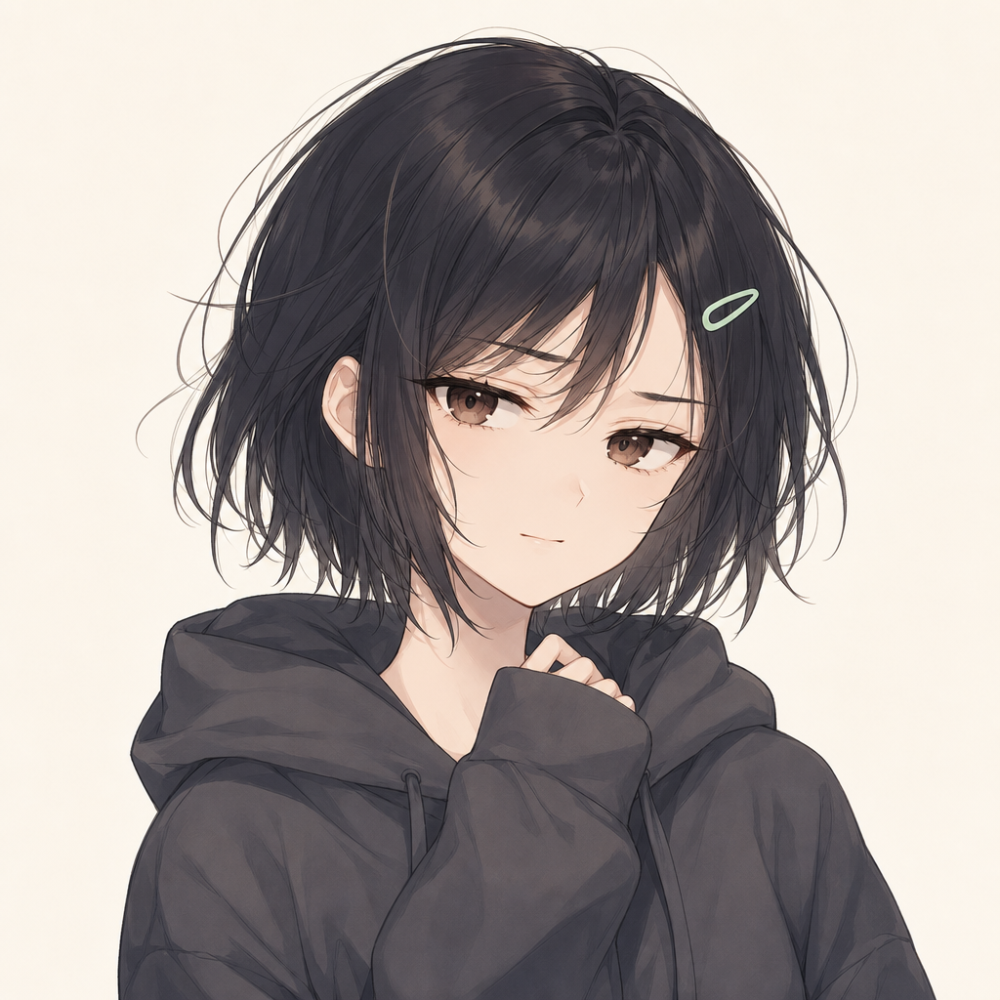

<div align="center">

# Debata_Agent（重构快照）

### **或许，`/v1/chat/completions` 后面的，是个人？**

[](https://www.python.org/)
[](LICENSE)
[](#)
[](#测试与验证)
[](#测试与验证)

</div>

---

> **这是一个私有重构快照，不是生产发布线。**
>
> - 仓库：[CN-BI5UNF/DebataBot](https://github.com/CN-BI5UNF/DebataBot)（私有，后续可公开）
> - 默认分支：`main`；`develop` 保留上一轮快照，便于对照。
> - 阶段 0～9 已在离线环境完成：运行时缓存、稳定前缀、主模型原生视觉、
>   独立视觉接口、协议转换、WebUI、usage 口径与合成基准。
> - 最后一次干净 venv 验证：`1908 passed`，`ruff check .` 通过。
> - GitHub Actions 当前 `main` 提交通过 Ubuntu/Windows × Python 3.11/3.12
>   四矩阵（pytest + ruff）。
> - 未调用真实付费视觉 API，未发送 QQ 消息，未重启生产服务。
> - 没有真实服务端 KV 命中率数据；本地估算和前缀测试不等于线上指标。

---

> 「虚拟角色不只是个会回复消息的程序，而是一个**真实的，能和你聊天的，有个性、有内心的**人。」

Debata_Agent 不绑定任何特定角色。你给它一个人格，它就活成那个人。
框架名取自项目第一个被实现的角色 Debata。

<div align="center">


*Debata —— 17 岁，短黑发，灰色卫衣。对亲近的人毒舌，但心里十分在意。*
</div>

## 目录

- [这次重构解决了什么](#这次重构解决了什么)
- [当前状态](#当前状态)
- [核心能力](#核心能力)
- [主模型原生视觉](#主模型原生视觉)
- [独立视觉接口](#独立视觉接口)
- [运行时缓存与稳定前缀](#运行时缓存与稳定前缀)
- [配置](#配置)
- [安装与启动](#安装与启动)
- [测试与验证](#测试与验证)
- [合成基准](#合成基准)
- [兼容行为](#兼容行为)
- [项目结构](#项目结构)
- [安全与隐私](#安全与隐私)
- [已知限制](#已知限制)
- [下一步（需要明确授权）](#下一步需要明确授权)
- [文档](#文档)
- [License 与致谢](#license-与致谢)

## 这次重构解决了什么

Debata_Agent 原本已经能聊天、记忆、调用工具和发送 QQ 消息，但长会话里存在三类真实成本：

1. **重复估算**：同一段 system、schema 和聊天内容被反复 tokenizer 编码；
2. **前缀不稳定**：旧运行时快照、历史工具噪声和易变上下文混在请求前部，
   让服务端 KV cache 难以复用；
3. **图片链路缺失**：主模型不能直接看图，或者只能靠独立视觉 API 额外调用。

这次重构不是换语言，而是重新整理“发给模型的那一份请求”：

- 相同内容只冷编码一次，raw token 进入有界内容寻址 LRU；
- 固定 system / 工具 schema / 稳定聊天前置，易变块统一进入尾部；
- 原生图片只出现在真实用户消息的位置，不破坏稳定前缀；
- 图片预算与文字预算分开，图片 token 使用显式资源预留，不冒充供应商账单；
- 历史记录、归档、工具原始结果不被模型视图改写或删除；
- 原生视觉和独立视觉接口完全独立，任何一个开关都不偷偷切换另一条路。

## 当前状态

| 阶段 | 内容 | 状态 |
|---|---|---|
| 0 | 工作树备份、隔离测试环境 | ✅ 完成 |
| 1 | `ModelViewPolicy` 单一来源、公共参数贯通 | ✅ 完成 |
| 2 | raw-token 内容寻址 LRU、图片预算公共接口 | ✅ 完成 |
| 3A | 严格 no_action 资格、失败语义、统一模型记录投影 | ✅ 完成 |
| 3B | 请求展示分区、结构稳定边界、12 轮前缀回归 | ✅ 完成（离线） |
| 4 | 入站图片资产、`ImageAssetStore`、可信 metadata | ✅ 完成 |
| 5 | 图片预算 profile、三个成功出口、摘要保护 | ✅ 完成 |
| 6 | `auto/on/off` 能力矩阵、独立 provider 隔离 | ✅ 完成 |
| 7 | OpenAI/Anthropic 图块、WebUI、dump/诊断脱敏 | ✅ 完成 |
| 8 | usage 口径 v2、缓存观测、新旧记录兼容 | ✅ 完成 |
| 9 | 合成基准、12 轮含图前缀、组合回归 | ✅ 完成 |

> 状态含义是“代码和离线测试已完成”，不是“真实供应商 API 已验证”或“已上线”。

## 核心能力

- **人格系统**：人格 prompt、动态状态、关系与记忆独立于主请求缓存。
- **QQ / NapCat 接入**：WebSocket 客户端/服务端模式、私聊/群聊、发送队列。
- **多轮工具循环**：发送、撤回、记忆、搜索、天气、定时唤醒、子 Agent 等。
- **长期记忆**：重要记忆文件与 RAG 两种模式，归档不改写原始历史。
- **滚动摘要**：按 token、图片数量和图片编码字节共同压缩；摘要只读文本历史。C02 增加软触发/增长预测、冷却、最少新增 token、失败退避和手动立即压缩。
- **WebUI**：FastAPI 后端 + 无构建步骤的静态前端，支持设置、向导、运行状态、安全清理与在线代码更新。
- **在线更新**：设置 → 更新，从 GitHub Releases/tag 选择更新或回退版本；只改源码，不覆盖数据目录；支持可信 https 镜像，依赖变化/脏工作树会拒绝；自动检查默认每 9 天一次。
- **主模型原生视觉**：图片直接进入主模型请求，避免默认双调用。
- **独立视觉接口**：`describe_image` 可选开启，只有需要时才调用独立 provider。
- **资源护栏**：图片路径、公网下载、尺寸、像素、数量、编码字节和请求体均有边界。

### 请求结构（简化）

```text
system 固定提示
system admin 信息
稳定聊天历史 S（真实用户消息 + 可安全回放的记录）
历史 runtime / 安全 no_action 快照尾区
当前 task_context
长期记忆 / 滚动摘要 / RAG
当前 user_event
```

稳定历史里如果有可信图片引用，图片在“所属真实用户消息”内部展开为
`text + 归属文本 + image_url/data URL`；消息条数不变，边界下标不漂移。

## 主模型原生视觉

### 数据流

```text
IncomingMessage.media
  → 来源解析与安全校验（opaque file_id / 公网 URL / workspace）
  → ImageAssetStore 一次规范化、校验、内容寻址落盘
  → metadata.image_assets（只含小 JSON ref，不含 base64/URL）
  → model view / 请求稳定分区
  → 预算视图（图片占位，不加载文件）
  → 预算通过后 materialize
  → OpenAI image_url 或 Anthropic image/source
  → provider 调用
```

### 开关

```yaml
features:
  vision:
    main_model_images: auto   # auto | on | off
    enabled: false            # 独立 describe_image 接口
```

| 配置 | 行为 |
|---|---|
| `auto` | 只对已核实能力的具体 provider/preset + model 开启。当前 `deepseek-flash` 已收录 vision；`deepseek-v4-pro` / legacy 不自动开启 |
| `on` | 明确声明该模型可接收标准图片，但仍要求协议支持图片转换（不支持时不会附图） |
| `off` | 不向主模型附图；不影响独立视觉接口和已保存的图片资产 |

独立开关组合：

| 原生 | 独立 | 行为 |
|---|---|---|
| 开 | 关 | 主模型直接看图，独立 API 零调用 |
| 开 | 开 | 仍优先原生；只有模型按需调用 `describe_image` 才走独立 API |
| 关 | 开 | 主模型只收到文本占位，可按需调用 `describe_image` |
| 关 | 关 | 明确图片没有提供给模型，不凭文件名/URL 猜画面 |

> 同时开启不代表自动双调用。主模型能看图时，不会在每轮预先调用一次视觉 API。

### 图片资源护栏

默认值即项目硬上限，只允许向下收紧：

| 限制 | 默认值 |
|---|---|
| 单图原始/规范化文件 | 8 MiB |
| 解码像素 | 20,000,000 |
| 规范化最长边 | 2048（不放大） |
| 每条入站消息图片 | 4 |
| 单次主请求图片 | 20 |
| 单次请求图片编码总量 | 24 MiB |
| 单次完整请求体 | 30 MiB |
| 图片编码 LRU | 32 MiB |
| 每图 token 预留 | 8192（可配 256～65536） |

**重要：图片 token 是资源预留，不是供应商精确账单。**
当前 profile 为 `reserve_v1`，`basis=configured_reserve`，`exact=False`。
DeepSeek 官方文档确认 `deepseek-flash` 接收标准 text/image_url 块，
但本仓库没有编造其图片 token 精确公式；真实计费需用授权后的小流量验证。

### 安全边界

- 只从真实入站媒体段、已校验 workspace 路径或明确 http(s)/data URL 进入；
  用户文本里的任意本地路径不会被当作文件上传。
- 下载只允许公网 http/https，拒绝 userinfo、内网、loopback、link-local、
  metadata 地址和混合 DNS；每跳重定向重新验证；固定解析 IP + 原 Host/SNI。
- 本地图片必须是普通文件，拒绝 FIFO/设备/目录逃逸/符号链接/任意绝对路径。
- 历史只保存内容寻址小 JSON ref；请求 dump、KV 诊断、工具结果不回显
  完整 base64 或签名 URL。
- 已接纳资产后来缺失/损坏时，主请求明确失败，不静默删图或换 URL。

## 独立视觉接口

`describe_image` 复用同一套安全图片加载器：

- workspace 相对路径必须通过 workspace 边界；
- http(s) URL 走统一受限下载，不只对 QQ 域名生效；
- data URL 显式解析、严格 base64、真实格式/尺寸/字节限制；
- 结果中的 `image_ref` / `message_url` 只保留 hash、host 或受管相对路径。

启用独立接口需要有效的 provider/model，或 `api_key_id + base_url`。
独立密钥使用专用 `vision_key`，不会覆盖主 provider 的密钥；关闭接口不会删除配置
或密钥，重新开启即可继续使用。

## 运行时缓存与稳定前缀

### raw-token LRU

- 键：`(model, tokenizer_backend_identity, utf8_byte_length, sha256)`
- 只保存 raw token 整数，不保存原文、messages 或 schema 对象；
- 容量 2048，进程级共享，内容相同的新对象/新 Estimator 可复用；
- 校准系数在缓存外应用，系数变化不会污染 raw 值；
- 文本校准来自 provider 真实 `prompt_tokens`；含图请求不更新纯文字校准。

### 模型视图

- 历史原文、归档和事件库不变；
- 旧 runtime 快照、严格成功的单次 no_action 组、重复发送回执可只影响模型副本；
- 失败 no_action、reasoning、多调用、loop_reminder、未知字段保留；
- 安全 no_action 在请求尾区变成带 `tool_call_id`/时间来源的快照，不裸搬配对。

### 请求分区与摘要

- 稳定聊天前置，runtime/安全历史 tail 后置；
- `_prompt_section=volatile_tail` 是请求副本的内部标记，不写回 history；
- runner 入口冻结稳定边界，同轮工具结果只能追加；
- 摘要按 token、图片数量、图片编码字节选择整条记录退出活跃窗口；
- 本轮尚未回答的用户输入有保护登记，压缩切点不能越过它。

## 配置

完整配置见 `app_config/schema.py`。常用项：

```yaml
behavior:
  context:
    max_context_tokens: 131072       # 工作预算，不是模型硬上限
    reserve_output_tokens: 4096
    memory_token_budget: 4096
    summary_token_budget: 4096
  summarize:
    trigger_at_context_percent: 50
    target_after_context_percent: 30
  tool_schema_profile: compact       # full 保留为回滚
  auto_finish_after_send: true
  kv_prompt_diagnostics: summary     # off | summary | full

features:
  long_term_memory:
    mode: file                       # file | rag
  vision:
    main_model_images: auto
    enabled: false
    type: api
    provider: ""                     # provider ID；或同时填 api_key_id+base_url
    model: ""
    api_key_id: ""
    base_url: ""
    image_budget_profile: reserve_v1
    image_token_reserve: 8192
    image_limits:
      max_images_per_message: 4
      max_images_per_request: 20
      max_encoded_image_bytes: 25165824
      max_request_body_bytes: 31457280
```

设置页与向导都支持主图策略（自动/开启/关闭）和独立视觉接口。
配置保存后是否需要重启由设置页标注；本项目不会在保存时自动重启服务。

## 安装与启动

要求 Python 3.10+；本快照实际验证环境为 Python 3.12 / Linux ARM64（Allwinner H618）。

```bash
cd Debata_Agent
python3.12 -m venv .venv
source .venv/bin/activate
pip install --upgrade pip
pip install ".[dev]"
```

首次配置：

```bash
python main.py --no-gui --setup
```

启动 WebUI：

```bash
python main.py --token 你的固定令牌
```

常用参数：

```bash
python main.py --no-auth          # 关闭 WebUI 鉴权，仅限可信内网
python main.py --no-gui           # 纯命令行
python main.py --napcat            # 重新配置 NapCat
python main.py --test-adapter      # 测试 NapCat 连接后退出
```

正式部署前请备份 `config.yaml`、`secrets.enc`、workspace 和聊天库，并准备回滚窗口。

## 测试与验证

### 干净环境（本次交付）

```bash
python3.12 -m venv /tmp/debata-native-vision-clean-c10
/tmp/debata-native-vision-clean-c10/bin/pip install --upgrade pip
/tmp/debata-native-vision-clean-c10/bin/pip install ".[dev]"
/tmp/debata-native-vision-clean-c10/bin/python -m pytest tests/ -q \
  --ignore=tests/test_kv_cache_real.py -p no:cacheprovider
/tmp/debata-native-vision-clean-c10/bin/ruff check .
```

结果：

```text
1908 passed in 398.72s
All checks passed!
git diff --check: OK
```

环境版本：

```text
Python 3.12.3
anthropic 0.116.0
Pillow 13.0.0
pytest 9.1.1
ruff 0.17.1
httpx 0.28.1
```

> `uv.lock` 中 Pillow 解析为 12.3.0；干净 pip 环境解析为 13.0.0。
> 两者分别在报告中标注，不声称完全一致。
> `tests/test_kv_cache_real.py` 需要真实 API/网络，默认不跑。

### GitHub Actions

当前 `main` 提交已在 GitHub Actions 的四个矩阵任务上通过：

```text
Ubuntu 3.11  ✅ pytest + ruff
Ubuntu 3.12  ✅ pytest + ruff
Windows 3.11 ✅ pytest + ruff
Windows 3.12 ✅ pytest + ruff
```

Windows 测试中的 FIFO 断言按平台跳过，符号链接创建受权限限制时跳过；
其余图片路径/原子写/安全校验照常运行。

### 定向测试

```bash
python -m pytest \
  tests/test_token_budget.py \
  tests/test_image_assets.py \
  tests/test_image_budget.py \
  tests/test_image_contracts.py \
  tests/test_inbound_image_assets.py \
  tests/test_provider_image_payloads.py \
  tests/test_providers_anthropic.py \
  tests/tools/test_feature_tools.py \
  tests/agents/test_kv_diagnostics.py \
  tests/integration_pipeline/test_native_vision.py \
  tests/webui_config/test_setup_config.py -q
```

## 合成基准

不读生产 DB/config/secrets，不启动 Runtime，不调用模型或 QQ：

```bash
python scripts/benchmark_prompt_tokens.py \
  --synthetic --scenario all --rounds 20 --repeats 200 --seed 42 \
  --json-output /tmp/debata-benchmark.json
```

本机干净环境样本（aarch64 / 4 CPU / Python 3.12.3）：

```text
text:   cold 2819.7ms（含 tokenizer 初始化）
        hot p50 1.78ms / p95 2.27ms（200 次）
        raw LRU hits=750 misses=3
prefix: 20 轮 stable_prefix_invalidations=0
        最后稳定区 701 token / 40 条记录
images: 4 ingest / 80 read / 4 encode
        76 cache hits / 1 eviction
        wire 全部受管 data URL；history 无 base64
        provider_calls=0, independent_vision_calls=0
```

说明：

- 冷时间包含 tokenizer 首次加载；热路径是本地估算，不是网络延迟。
- 32MiB 图片编码 LRU 不等于进程峰值内存；请求自身 base64 副本与原生编码器
  峰值需另行测量。
- 稳定前缀测试证明本地结构稳定，不代表服务端 KV 命中率一定提升。

## 兼容行为

- **旧纯文本 history**：没有 `metadata.image_assets`，正常文本回放，不联网重抓。
- **旧 v1 图片资产**：`pillow-first-frame-v1` 只读兼容；新图写
  `pillow-first-frame-max2048-v2`。
- **用户文字里的 `[图片 workspace=...]`**：只当文字，不自动上传。
- **原生关闭**：仍可保存受管图片供以后或独立工具使用，但不向主模型附图。
- **资产损坏/丢失**：主请求明确失败，不静默删图、不换 URL。
- **旧 usage 记录**：没有 `usage_semantics_version`，按 legacy 展示；
  新记录 v2 的 `prompt_tokens` 是完整输入（含 cache read/create）。
- **旧工具结果**：失败 no_action、reasoning、loop_reminder 等保持原样保留。

## 项目结构

```text
DebataBot/
├── adapters/               渠道适配器（NapCat 等）
├── providers/              LLM 协议、预设与能力矩阵
├── agents/                 主聊天 / 主动思考 / 总结 / 人格管理 / 社交
├── mind/                   人格状态、用户画像、关系、线索、待办
├── memory/                 历史、重要记忆、归档、RAG、用量存储
├── tools/                  AI 工具、schema 分级、安全图片工具
├── features/               视觉、TTS、天气、搜索、Embedding
├── core/                   事件总线、消息管道、Runtime、模型视图
├── app_config/             配置、路径、密钥加密
├── webui/                  FastAPI 后端 + 静态前端
├── plugins/                本地模型插件
├── utils/                  CQ 解析、token 估算、图片契约、请求分区
├── personas/               人格目录
├── scripts/                验证、基准与维护脚本
└── tests/                  单元、协议、集成与 WebUI 回归
```

关键模块：

- `utils/token_budget.py`：raw-token LRU、token 估算、图片预算。
- `utils/image_contracts.py`：图片 ref、限额、路径与归属契约。
- `features/vision/image_assets.py`：安全下载、规范化、内容寻址与请求投影。
- `core/pipeline_working_context.py`：主请求预算、三出口、最终 wire 校验。
- `core/pipeline_summary.py`：多维摘要、受保护输入切点。
- `core/model_view.py`：非破坏性模型视图与安全 no_action sidecar。
- `providers/protocols/anthropic_proto.py`：Anthropic 文本/工具/图片转换。

## 安全与隐私

- `config.yaml`、`secrets.enc`、`data/`、个人人格、日志和 workspace 已被
  `.gitignore` 排除，不进入仓库。
- WebUI 默认令牌鉴权；`--no-auth` 只适合完全可信的内网。
- 公网访问请使用 Nginx/Caddy 反向代理 + HTTPS，或只监听 `127.0.0.1`。
- 长期服务请使用专用用户，不要用 root。
- 独立视觉密钥使用专用 secret 引用，不写进主 provider；日志只显示
  “是否已配置”和引用 ID，不返回真实 secret。
- 图片 base64、签名 URL、请求 dump 和 KV 诊断都按受控字段脱敏。
- 聊天记录、人格和配置属于个人数据；迁移或分享前请备份并脱敏。

## 已知限制

1. **未调用真实付费视觉 API**：原生链路、OpenAI/Anthropic 载荷、独立工具
   均由 fake provider / mock HTTP 验证；真实供应商限流、400/413 行为和
   图片计费仍需授权后的小流量验证。
2. **图片 token 是预留，不是账单**：`reserve_v1` 不是供应商精确公式，也不是
   数学上界。
3. **没有线上 KV 命中率**：本地稳定前缀和 raw LRU 不能替代服务端指标。
4. **旧无 metadata 的 runtime 记录保守保留**，可能增加部分旧历史 prompt；
   这是为避免误删真实聊天。
5. **旧 usage 记录按 legacy 展示**：新旧口径不直接混算命中率。
6. **本机只验证 Linux ARM64 / Python 3.12**；GitHub Actions 当前 `main`
   提交已通过 Ubuntu/Windows × Python 3.11/3.12 四矩阵，但真实视觉 API
   仍未在 CI 中调用。
7. **本仓库是重构快照**，不包含上游完整提交历史；上游稳定版本见
   [binglang001/Debata_Agent](https://github.com/binglang001/Debata_Agent)。

## 下一步（需要明确授权）

1. 在隔离测试账号/小流量环境验证真实 DeepSeek / Anthropic 图片请求与计费；
2. 根据真实 `prompt_tokens` 反馈评估是否需要具体供应商 token profile；
3. 观察服务端 KV cache 命中率，确认稳定前缀收益；
4. 需要部署时由用户决定重启方式、备份与回滚窗口。

本仓库和本 README 不是上线授权。真实 API 调用、生产部署、服务重启都需要
单独确认。

## 文档

- [图文教程](docs/getting_started.md) — 从零开始
- [后台运行指南](docs/background_running.md) — systemd / tmux / screen / nohup
- [功能列表](docs/features.md) — 真人聊天、记忆、人格、WebUI
- [角色编写指南](docs/persona_writing_guide.md) — 怎么写会「活」的人格
- [架构总览](docs/architecture.md) — 模块依赖、模型视图、Token 计量
- [KV 缓存基准](docs/kv_cache_benchmark.md) — 真实命中率与重构后估算
- [提供商开发](docs/provider_development.md) — 接新的 LLM
- [适配器开发](docs/adapter_development.md) — 接新的聊天平台
- [WebUI 说明](docs/webui.md) — 页面结构、接口一览
- [存储与缓存维护](docs/storage_maintenance.md) — 分页、盘点、安全清理与预算状态
- [UI 风格指南](docs/ui_style_guide.md) — 设计原则与配色

## License 与致谢

本项目源自 [binglang001/Debata_Agent](https://github.com/binglang001/Debata_Agent)
及其贡献者，保留原始版权与协议声明。

本重构快照由 [CN-BI5UNF](https://github.com/CN-BI5UNF) 维护，
用于验证缓存、前缀与原生视觉重构；完整稳定版本请参考上游。
